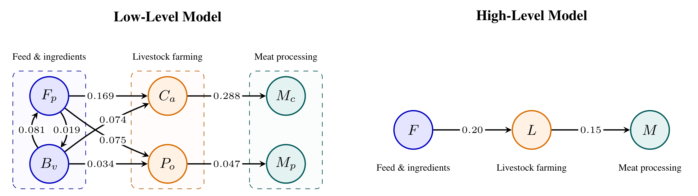
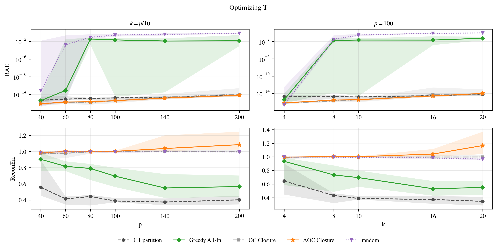
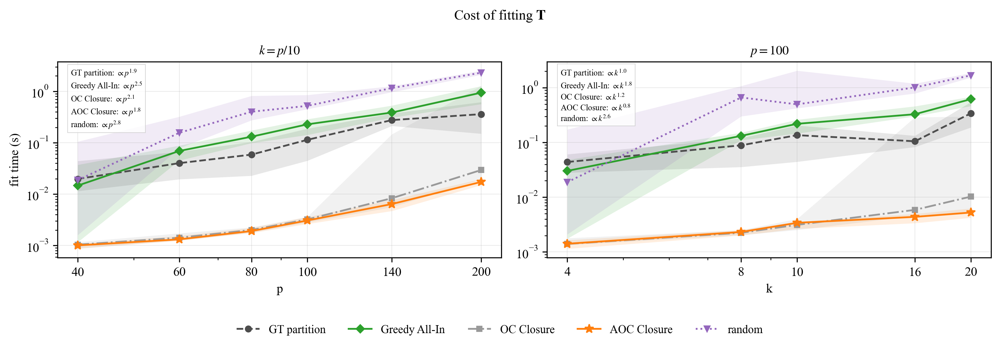
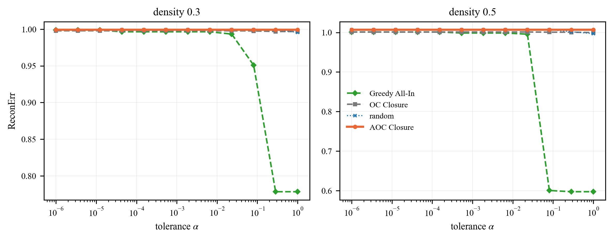
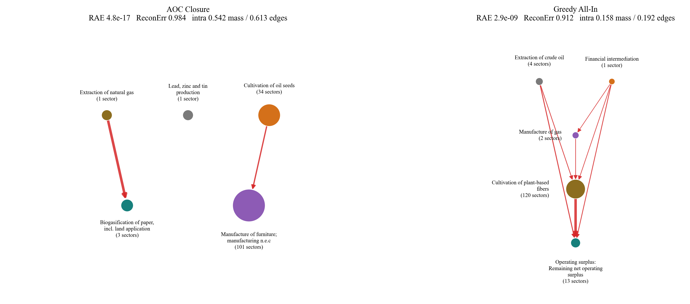

# Causal Abstraction of Linear Systems: Sufficient Conditions and Methods

## Overview

Large causal systems often admit multiple levels of description. For example, an economy might be described at its lowest level by the flows between individual businesses and consumers: who supplies which goods and services to whom. We may instead describe the same economy in terms of industrial sectors, specifying the relations between these broad sectors (i.e. how much each sector buys from other sectors to produce one unit of its own product). We want to be able to take our simpler description of the economy and make predictions that are consistent with the original, "low-level" model of the economy even when we intervene (e.g. subsidise a certain sector or place tariffs). Causal Abstraction (CA) provides the formal framework for this idea. 

This repository allows the learning of causal abstraction given a "low-level" causal model.
Using just the adjacency matrix of the model (which specifies which variables are causally connected), we partition the low-level variables into clusters and then learn a linear map that aggregates each cluster into a single "high-level" variable (e.g. representing thousands of businesses by a single sector variable).
We can then define a causal model over these high-level variables (the "high-level" model) which respects the low-level model in a sense formalised by [Beckers & Halpern (2019)][bh19].
The algorithms work for real-world input-output data as well as for a broad class of low-level models that satisfy some formal conditions.


<p align="center">
  
</p>
<p align="center"><em>
  Six UK sectors from the EXIOBASE input&#8209;output table: food products
  (F<sub>p</sub>), beverages (B<sub>v</sub>), cattle (C<sub>a</sub>),
  poultry (P<sub>o</sub>), cattle meat (M<sub>c</sub>) and poultry meat
  (M<sub>p</sub>). Edge weights are the monetary input from industry
  i needed per unit of output in industry j. The clusters
  satisfy All&#8209;In and One&#8209;Child with an acyclic cluster graph; the conditions proven
  sufficient for exact abstraction here. <code>greedy_allin</code> recovers exactly this
  partition from the weight matrix alone (<code>experiments/intro_example.py</code>).
</em></p>

---

## Installation

```bash
python -m venv venv && source venv/bin/activate
pip install -r requirements.txt
pip install -e .
```

The editable install is what makes `import src...` and `import experiments...` resolve from
any working directory. Without it the scripts only run from the repository root.

## Quick start

```python
import numpy as np
from src.utils.generate_data import sample_low_level_graph
from src.algos.greedy import aoc_closure, greedy_allin
from src.algos.T_fitter import fit_abstraction_eigen
from src.utils.losses import RAE, reconstruction_loss

# a 100-variable linear SCM
A_low, *_ = sample_low_level_graph(n_high=10, n_low=100, density=0.5, seed=0, shuffle=True)
E_low = np.linalg.inv(np.eye(A_low.shape[0]) - A_low)

for name, partition in [("aoc_closure",  aoc_closure(A_low, 10, n_restarts=10, seed=0)),
                        ("greedy_allin", greedy_allin(A_low, 10))]:
    A_high, T, S = fit_abstraction_eigen(A_low, partition, seed=0)   # stage 2: fit the weights
    print(name,
          "RAE %.2e" % RAE(A_low=A_low, T=T, A_high=A_high, S=S, E_low=E_low),
          "ReconErr %.4f" % reconstruction_loss(A_low=A_low, T=T, A_high=A_high))
```

```
aoc_closure    RAE 8.53e-15   ReconErr 1.0662
greedy_allin   RAE 5.65e-01   ReconErr 0.9852
```

Both stages are visible here: `aoc_closure` picks a partition that satisfies both sufficient
conditions, so the fitted abstraction is exact to machine precision — but it buries so much
structure that it reconstructs `A` worse than doing nothing. `greedy_allin` gives up
exactness and buys back reconstruction.

## Theoretical Overview

### Background
We consider linear Structural Causal Models (SCMs) over a finite set of variables, i.e. a tuple $`(\mathbf{X}, \mathbf{A}, \mathbf{U}, \mathbb{P}(\mathbf{U}))`$ where
* $`\mathbf{A} \in \mathbb{R}^{p \times p}`$ is a weight matrix,
* $`\mathbf{U} \in \mathbb{R}^{p}`$ is a set of $`p`$ unobserved (exogenous) random variables with joint distribution $`\mathbb{P}(\mathbf{U})`$ and
* $`\mathbf{X} \in \mathbb{R}^{p}`$ is a set of $`p`$ observed (endogenous) random variables determined by the equation

```math
\mathbf{X} = \mathbf{A}^{T}\mathbf{X} + \mathbf{U}
```

Given a linear Structural Causal Model (SCM) $`\mathcal{M}_{\mathcal{L}}`$ over $`p`$ variables $`\mathbf{X} = (X_{1},\dots X_{p})`$, we can define
* a $`k`$-partition of the variables, i.e. a surjective map $`\pi^{-1} : \{1,...,p\} \rightarrow \{1,...,k\}`$ where we write $`\pi(i) := (\pi^{-1})^{-1}(i)`$ for the set of variables in cluster $`i`$,

* a linear aggregation map $`\mathbf{T} \in \mathbb{R}^{p\times k}`$ such that the $`(r,j)`$'th entry of $`\mathbf{T}`$ is non-zero if and only if $`r \in \pi(j)`$ and

* an exogenous aggregation map $`\mathbf{S} \in \mathbb{R}^{p \times k}`$ such that the $`(r,j)`$'th entry of $`\mathbf{S}`$ is zero whenever $`r \notin \pi(j)`$.

These define variables $`\tilde{\mathbf{X}} := \mathbf{T}^{T}\mathbf{X}`$ and $`\tilde{\mathbf{U}} := \mathbf{S}^{T}\mathbf{U}`$ over which we can define a linear SCM $`\mathcal{M}_{\mathcal{H}}`$ with weight matrix $`\tilde{\mathbf{A}} \in \mathbb{R}^{k\times k}`$.

Causal Abstraction (CA) as defined by [Beckers & Halpern (2019)][bh19] requires that the abstraction mapping $`(\mathbf{X},\mathbf{U}) \overset{(\mathbf{T},\,\mathbf{S})}{\longmapsto} (\tilde{\mathbf{X}}, \tilde{\mathbf{U}})`$ remains consistent under *do-interventions* in both models; essentially we want the operations *intervene* and *abstract* to commute. [Massidda et al. (2024)][massidda24] show that for linear SCMs with acyclic graphs and linear maps, CA is equivalent to

<a id="eq-collinearity"></a>

```math
\mathbf{A}_{\pi(i)\pi(j)}(\mathbf{I} - \mathbf{A}_{\pi(j)\pi(j)})^{-1}\mathbf{T}_{\pi(j)j} = \tilde{A}_{ij}\mathbf{T}_{\pi(i)i}. \qquad (1)
```

They also provide a necessary condition on the partition $`\pi`$, which we call the **All-In** condition.

> **Definition (All-In).**
> $`\pi`$ satisfies the **All-In** condition if and only if, for all distinct clusters $`\pi(i), \pi(j)`$, *either* there are no cross-cluster edges $`X_{r} \rightarrow X_{s}`$ (with $`r \in \pi(i)`$ and $`s \in \pi(j)`$), *or* every variable $`r \in \pi(i)`$ has an edge $`X_{r} \rightarrow X_{s}`$ to some variable $`s \in \pi(j)`$.

### Contributions
 * We show that equation [(1)](#eq-collinearity) also applies to SCMs with weight matrices $`\mathbf{A}`$ that are non-negative and satisfy $`\rho(\mathbf{A}) < 1`$. This covers realistic economic input-output matrices which are typically cyclic but satisfy these conditions.

 * We show that in addition to the All-In condition, the following is a sufficient condition on $`\pi`$

> **Definition (One-Child).**
> $`\pi`$ satisfies the **One-Child** condition if and only if each cluster $`\pi(i)`$ has at most one child cluster outside of itself (i.e. $`\lvert \{\pi^{-1}(s) \mid X_{r} \rightarrow X_{s} \ \text{ for some } r \in \pi(i), \ s \notin \pi(i)\} \rvert \leq 1`$).

* We propose unsupervised greedy algorithms for learning partitions $`\pi`$ that satisfy the All-In and/or One-Child conditions as well as a gradient-based algorithm.

* We propose an algorithm for learning $`\mathbf{T}`$ (and $`\mathbf{S}`$) given a partition $`\pi`$.

## Experiments

Every figure and table below is produced by the scripts in this repository; the command that
regenerates each one is given beneath it. $`p = 100`$, $`k = 10`$ unless stated.

### Learning the partition

We introduce three agglomerative algorithms designed to learn graph partitions that satisfy the All-In and/or One-Child conditions. The table below shows how they compare on random graphs including the proportion of graph edges that are 'buried' within clusters (a proxy for how much information of the graph structure is destroyed).

| Method | All-In &darr; | 1-child &darr; | info &darr; |
|---|---|---|---|
| AOC Closure | **0.000** | **0.000** | 0.626 |
| OC Closure | 0.292 | **0.000** | 0.446 |
| Greedy All-In | **0.000** | 0.780 | **0.000** |
| *ground truth* | 0.000 | 0.650 | 0.000 |

<sub>Median over `n = 40` instances. `p = 100`, `k ≤ 20`, density 0.5, blockiness 0.8,
ground truth `k* = 10`, 12 closure restarts. All three columns are violation rates on a common
`[0,1]` scale; lower is better, `0.000` ideal. Regenerate with
`python experiments/synthetic/partition_table.py`.</sub>

**AOC Closure** is the only one that satisfies both conditions (All-In
`0.000`, 1-child `0.000`), and so is the only one guaranteed an exact abstraction — but it
buries `0.626` of the edges inside clusters. **Greedy All-In** buries none (`0.000`) but does
not satisfy the One-Child condition, though this condition is not necessary, only sufficient:
the ground-truth partition (for which an exact causal abstraction is known to exist) scores `0.650` on 1-child.

### Fitting T on a given partition

Given a partition of a causal graph $`\pi`$, we define a **cluster graph** by taking the partition clusters as nodes and drawing edges between these nodes if there is a low-level edge between the clusters (i.e. a "quotient graph" over clusters). For each cluster $`i`$, we want to learn a vector $`\mathbf{t}_{i} := \mathbf{T}_{\pi(i)i}`$ satisfying equation [(1)](#eq-collinearity). Write $`\mathbf{M}_{ij} := \mathbf{A}_{\pi(i)\pi(j)}(\mathbf{I} - \mathbf{A}_{\pi(j)\pi(j)})^{-1}`$ and observe that $`\mathbf{t}_{j}`$ determines the direction of $`\mathbf{t}_{i}`$ whenever there is an edge $`i \rightarrow j`$ in the cluster graph. We thus parameterise the $`\mathbf{t}_{j}`$ for the sink clusters and require that for non-sink clusters $`i`$ with children $`j_{1},\dots,j_{l}`$, $`\mathbf{M}_{ij_{1}}\mathbf{t}_{j_{1}},\dots,\mathbf{M}_{ij_{l}}\mathbf{t}_{j_{l}}`$ are parallel vectors. Taking the average direction we can determine $`\mathbf{t}_{i}`$ and propagate the same requirement to its parents and so on. This sets up a smooth, non-convex least-squares optimisation problem which we can solve using off-the-shelf methods. Where there are cycles, we also parameterise $`\mathbf{t}_{i}`$ for one cluster in each **cyclic component** of the cluster graph — a maximal group of clusters that can all reach one another.

<p align="center">
  
</p>

<sub>Median over 20 instances, shaded band the interquartile range. Density 0.5, blockiness
0.8; the generating model has `k` clusters and every learner is given a budget of `k`.
Regenerate with `python experiments/synthetic/sweeps.py` (about 13 minutes). This validates our theoretical results about the sufficiency of
the All-In and One-Child conditions since AOC Closure always achieves 0 RAE.</sub>

Given a partition, we can then learn $`(\mathbf{T},\tilde{\mathbf{A}}, \mathbf{S})`$. Note that $`\mathbf{S}`$ and $`\tilde{\mathbf{A}}`$ (`A_high`) follow analytically from $`\mathbf{T}`$ and $`\mathbf{A}`$ (`A_low`). The relevant metrics for a partition are

**RAE**, which measures the exactness of the abstraction (i.e. how much it violates the formal conditions) relative to the natural variation of the abstracted variables under the model's own exogenous distribution.

**ReconErr**, which loosely measures how much information about the low-level model we lose after abstraction.

Note that both are important and often need to be traded off: RAE can be driven to zero by collapsing
every low-level variable into one cluster while we can maximise ReconErr by not abstracting at all.

**A caveat on cost:** Learning the partition is relatively cheap but fitting $`\mathbf{T}`$ via
`fit_abstraction_eigen` is the runtime bottleneck. Suppose there are $`S`$ sink clusters and
$`C`$ cyclic components. If each cluster has size $`c \approx p/k`$ then we have $`(S + C)c`$
learnable parameters. The objective requires computing $`\mathbf{M}_{ij}\mathbf{t}_{j}`$ for
each cluster-graph edge $`i \rightarrow j`$, and so if the cluster graph has density $`d`$, this is
computed $`dk(k-1)`$ times with $`O(c^{2})`$ operations each time. Over $`R`$ restarts and $`I`$
iterations, the learning algorithm for $`\mathbf{T}`$ is

```math
O\left(R \cdot I \cdot d \cdot (S + C) \cdot \frac{p^{3}}{k}\right)
```

which is **cubic in $`p`$** in the worst case. In fact since $`S + C \leq k`$, the bound simplifies to $`O(R \cdot I \cdot d \cdot p^{3})`$.
The Jacobian is computed in closed form rather than by finite differences, which cuts the
constant by about 7×.

The measured cost, on the same instances and the same two axes:

<p align="center">
  
</p>

<sub>Median wall time of `fit_abstraction_eigen` alone — not the partition search — over the
same 20 instances and the same two axes as the figure above, shaded band the interquartile
range. Log-log, so a power law is a straight line; the annotation in each panel is the
exponent of a least-squares fit of log time on log `p` (left) or log `k` (right). Produced
by the same `python experiments/synthetic/sweeps.py` run.</sub>

### The exactness–informativeness trade-off

<p align="center">
  
</p>

<sub>Median over 20 instances. `p = 100`, `k = 10`, blockiness 0.8, 12 closure restarts.
Regenerate with `python experiments/synthetic/benchmark.py` (about 3 minutes); the instances
are drawn under `--seed 0`, so the numbers quoted below come back exactly. `--seed -1` draws
fresh ones, and at 20 instances the spread between draws is wider than the gaps below.</sub>

Fix a tolerance $`\alpha`$ in advance, and accept a learned abstraction only if its RAE is
within $`\alpha`$ *and* it reconstructs better than AOC Closure; otherwise fall back to AOC Closure, which
is guaranteed to admit one. Each curve represents the typical `ReconErr` you would have if you had the hard constraint RAE $`\leq \alpha`$ and access to AOC Closure as a fallback.

**Greedy All-In is the only method that meaningfully trades RAE tolerance for ReconErr.** As RAE tolerance loosens, Greedy All-In's ReconErr falls from `0.994` to
`0.878` at `density 0.3`, and from `1.011` to `0.762` at `density 0.5`, while every other method barely deviates from the AOC Closure line near `1.00`.

### A UK input–output economy

<p align="center">
  
</p>

172 UK sector and factor-input rows from EXIOBASE, pruned at $`\lvert a \rvert > 0.05`$, which leaves 140
that still carry an edge. This is the cyclic, non-negative, $`\rho(\mathbf{A}) < 1`$ regime the theory here
extends to and that earlier work excluded. Each high-level node is labelled by its
highest-weighted member.
Both methods reach an exact abstraction here — RAE `4.8e-17` for **AOC Closure** and
`4.4e-16` for **Greedy All-In** — so on this economy the two differ only in how much they
tell you. AOC Closure collapses 101 of the 140 sectors into a single cluster and buries
`61.3%` of the edges, reconstructing $`\mathbf{A}`$ marginally better than an edgeless graph (ReconErr `0.984`).
Greedy All-In buries `19.2%` and reaches ReconErr `0.956`.

<sub>Regenerate with `python experiments/leontief/figure.py` (needs `data/A_low.npy` and
`data/A_low_labels.pkl`, written by `experiments/leontief/pipeline.py::parse_data`).</sub>

## Repository layout

```
src/algos/              stage 1: find a partition
  greedy.py               agglomerative -- aoc_closure, oc_closure, greedy_allin, random
  gradcap.py              gradient-based
  T_fitter.py             stage 2: fit (T, A_high, S) to a partition
  uca.py                  baseline (needs a third-party package)
src/utils/
  partition.py            operations on a partition: All-In violations, the cluster
                          graph, intra-cluster edges, merges, matrix conversions
  abstraction_algebra.py  the S, A_high and reconstruction a fitted T induces,
                          plus the DAG surgery applied to a fitted A_high
  generate_data.py        synthetic linear SCMs
  losses.py               RAE, reconstruction loss, diagnostics
  plots.py                figures and training animations

experiments/
  synthetic/
    benchmark.py        sweep machinery; the exactness-informativeness figure
    partition_table.py  the partition-quality table
    sweeps.py           RAE, ReconErr and the cost of fitting T as p and k vary
  leontief/
    pipeline.py         UK Leontief study; parses the EXIOBASE tables
    figure.py           the learned high-level graphs on that economy
    grouping.py         sector-grouping figures
  intro_example.py      can the README's headline partition be learned?
  mlp_abstraction.py    local linear SCM of a ReLU MLP

pyproject.toml   editable install; makes src/ and experiments/ importable
paper/           LaTeX fragments (algorithms, figures)
supplementary/   ICLR submission snapshot: minimal runnable code
assets/          figures used in this README
```

## Paper

<!-- Venue and status; link it once public. The submitted snapshot is in
     supplementary/ and the algorithm listings in paper/. -->

```bibtex
@inproceedings{TODO,
}
```

Related: [neural-causal-abstraction](https://github.com/15R437/neural-causal-abstraction) — the nonlinear case, `X = Φ(WᵀX + u)`, and abstractions of trained networks.

## References

- **Beckers & Halpern (2019).** [Abstracting Causal Models](https://arxiv.org/abs/1812.03789). *AAAI-19*, 2678–2685.
- **Massidda, Magliacane & Bacciu (2024).** [Learning Causal Abstractions of Linear Structural Causal Models](https://arxiv.org/abs/2406.00394). *UAI 2024*, PMLR 244:2486–2515. — the collinearity condition used by the fitter in `src/algos/T_fitter.py`; their [`causabs`](https://github.com/rmassidda/causabs) package is a dependency here.
- **Zhu, Garrido Mejia, Schölkopf & Besserve (2024).** [Unsupervised Causal Abstraction](https://neurips.cc/virtual/2024/105108). *NeurIPS 2024 Workshop on Causal Representation Learning.* — the UCA baseline; implementation kindly provided by the authors and not redistributed here (see `src/algos/uca.py`).

```bibtex
@inproceedings{beckers2019abstracting,
  title     = {Abstracting Causal Models},
  author    = {Beckers, Sander and Halpern, Joseph Y.},
  booktitle = {Proceedings of the 33rd AAAI Conference on Artificial Intelligence},
  pages     = {2678--2685},
  year      = {2019}
}

@inproceedings{massidda2024learning,
  title     = {Learning Causal Abstractions of Linear Structural Causal Models},
  author    = {Massidda, Riccardo and Magliacane, Sara and Bacciu, Davide},
  booktitle = {Proceedings of the 40th Conference on Uncertainty in Artificial Intelligence},
  series    = {PMLR},
  volume    = {244},
  pages     = {2486--2515},
  year      = {2024}
}

@inproceedings{zhu2024unsupervised,
  title     = {Unsupervised Causal Abstraction},
  author    = {Zhu, Yuchen and Garrido Mejia, Sergio Hernan and Sch{\"o}lkopf, Bernhard and Besserve, Michel},
  booktitle = {NeurIPS 2024 Workshop on Causal Representation Learning},
  year      = {2024}
}
```

## License

MIT — see [LICENSE](LICENSE).

[bh19]: https://arxiv.org/abs/1812.03789
[massidda24]: https://arxiv.org/abs/2406.00394
[zhu24]: https://neurips.cc/virtual/2024/105108
[causabs]: https://github.com/rmassidda/causabs
