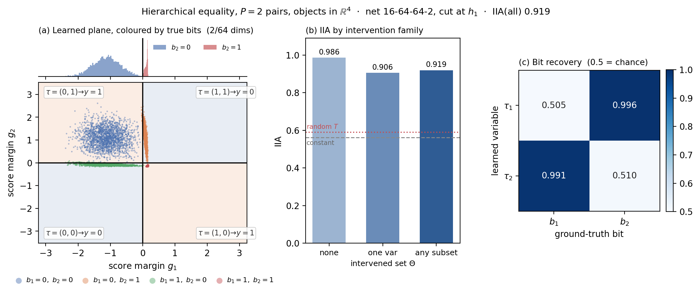
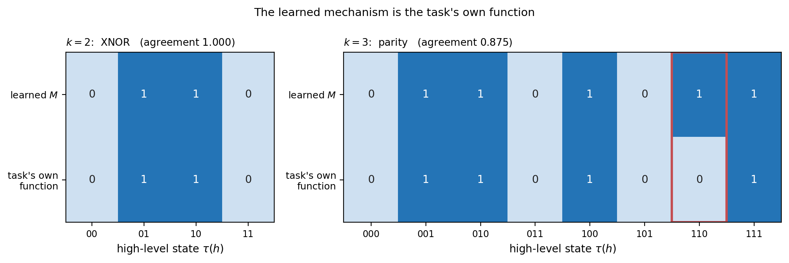
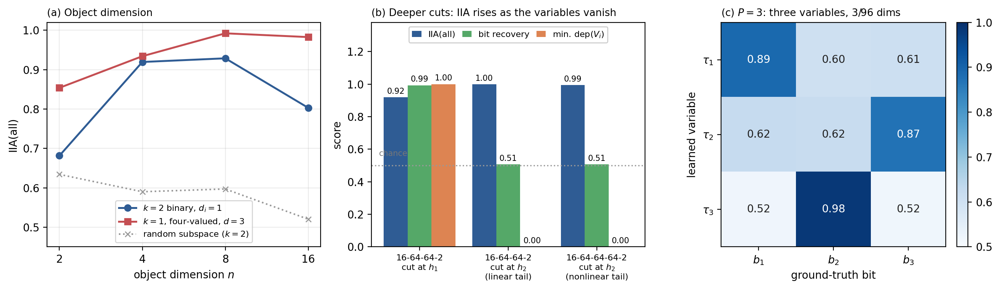

# Two (and three) high-level variables in a hierarchical-equality MLP

**Question.** The MNIST and XOR networks only ever abstracted cleanly at *one* high-level variable. Is that a
limitation of the fitter, or of the networks? This study says: of the networks — or more precisely, of the tasks
they were trained on. Given a task that forces a network to hold several independent pieces of state, the same
fitter in `src/algos/sigmoid_abstract.py` finds them, unchanged.

**Result.** On hierarchical equality with two pairs, cutting after the first hidden layer, **two binary variables on
2 of 64 dimensions reach IIA(all) 0.92 with purity 0.92**, the learned mechanism is exactly XNOR, and each learned
variable recovers one of the task's own bits at **0.99** (0.5 is chance) — on 6 of 8 seeds. A random subspace of the
same size scores +0.07 skill against the fitted +0.80. With three pairs, three binary variables on 3 of 96
dimensions reach IIA 0.77–0.83 with bit recovery up to 1.00. A single four-valued variable still fits *better* on
IIA (0.99), but on a strictly smaller intervention family — see §3.

**The warning that comes with it.** Cut the same network one layer later and IIA *rises* to 0.999 while bit recovery
falls to 0.506 and one of the two variables stops being used at all. High IIA at *k* variables is not evidence of
*k* variables. Two diagnostics introduced here separate the cases.

---

## 1. Why a new task

A classifier's decision is one region of activation space. One multi-valued variable on a small block already says
everything the interchange condition can test about *where the decision lives*, and nothing in the training
objective forces the network to keep two separately settable pieces of state. That is the `THEORY.md` observation
"When a single variable is vacuous", and it is why the MNIST sweep tops out at one variable.

**Hierarchical equality** (Geiger et al.'s task, generalised to *P* pairs) removes that excuse. An input is 2*P*
objects, each a vector in R^n; pair *i* is made identical with probability 1/2. The bits are
b_i = 1[x_{2i} = x_{2i+1}] and the label is their parity:

> y = 1 if b_1 + ... + b_P is even.

At *P* = 2 this is the usual "(a = b) = (c = d)". Two properties make it the right test:

- the bits are independent and uniform, so **all 2^P bit patterns occur in the data** and an interchange
  intervention on one bit names a state the network itself produces;
- **parity depends on every bit**, so a network that solves the task must hold all *P* at once. There is no
  halfspace shortcut to trade one bit off against another.

**Notation.** Throughout, *P* is the number of pairs in the **task** and *k* is the number of high-level
**variables** in the abstraction, matching `model.k` in `sigmoid_abstract.py`. They coincide only when we fit one
variable per pair (`P:2:d`); the single multi-valued fits have *k* = 1 at any *P*.

The networks solve it: 16-64-64-2 reaches test accuracy 0.9999 at *n* = 4, and 24-96-96-2 reaches 0.9987 at
*P* = 3.

### Where the cut goes is the whole experiment

Cut after the **last** hidden layer and the tail is linear, so the network's decision *is* a single halfspace: one
binary variable on one dimension reproduces it for free, and the exercise is vacuous. Cut after the **first** hidden
layer and the parity is still ahead of us in the network — the high-level model must get each bit's subspace right
*and* carry the parity table, and intervening on one bit has to flip the output. Everything below is at the first
hidden layer unless stated.

## 2. Two diagnostics beyond IIA

Both are introduced here and are not standard; both exist because IIA alone cannot distinguish a genuine *k*-variable
abstraction from a 1-variable one wearing *k* variables' clothes.

**`dep(V_i)` — mechanism dependence.** For each high-level variable, the share of realised cells whose predicted
class changes when *that variable alone* is changed to another value. `dep(V_i) = 0` means the mechanism ignores
variable *i* entirely. (Only alternatives that are themselves realised are counted: `M` is undefined on cells nothing
ever produces.)

**`bits` — bit recovery.** The task has known ground-truth bits, which is the point of using a synthetic
compositional task. For learned variable tau_i and true bit b_j, group the evaluation activations by the value
tau_i takes and predict the majority b_j in each group; the entry is that map's accuracy. The reported number is the
mean over the best one-to-one matching of learned variables to true bits (the tau's come out in arbitrary order).
0.5 is chance.

IIA says the abstraction is *valid*. Bit recovery says it found the task's *own* variables. These come apart, which
is the subject of §4.

**Bit recovery is only computable because we fixed a ground-truth high-level model in advance.** It is an instrument
of the study design, not part of the method: on MNIST, or on any network whose intended variables we do not already
know, there is nothing to match the learned tau against. So it is never used to select anything here — seeds are
chosen by IIA, which is the fitting objective and uses no ground truth, and `bits` is then an independent read-out
of the selected model.

That makes this task a **calibration of the ground-truth-free diagnostics**. In a real setting the only instruments
available are `dep`, `cells`, `purity`, the margin, and the random-subspace control; here we can ask whether those
actually track the thing we care about. Mostly they do — at the degenerate cuts of §4, `dep` falls to 0.00 exactly
where `bits` falls to chance, with no ground truth needed to see it. But the agreement is not perfect: one seed in
§5 has `dep(V_i) = 1.00` on both variables and still only 0.724 bit recovery. **`dep` is necessary, not
sufficient**, and the honest reading is that the ground-truth-free diagnostics catch the gross failures (a variable
that is ignored, a fit that collapsed to one cell) but do not certify that the variables mean anything in
particular.

## 3. The abstraction



**(a)** is the picture to keep. The axes are the two variables' score margins g_i = s_1 - s_0, so variable *i* reads 1
exactly where g_i > 0 and the boundaries are the axes themselves. The four colours are the four true bit patterns,
and **each lands in its own quadrant** — the fitter, which never saw a bit, carved the plane along them. The shading
is the class the learned table assigns each cell, and it is XNOR.

**(b)** IIA by intervention family. The gap between `obs` (no intervention) and `all` (any subset of variables
patched from a second input) is where the causal content lives; a constant model scores the base rate and a frozen
random subspace of the same size barely beats it.

**(c)** Each learned variable determines one true bit at ~0.99 and the other at chance — an exact, clean
correspondence, up to the arbitrary ordering.

### Full results

Every row is the best of 3 seeds by IIA (§5). Two different dimensions appear and are easy to confuse: **objects
in R^n** is the size of each of the 2*P* input object vectors (the `--dim` flag, the x-axis of figure 2a), while
**layer dims used** is *D* = sum of d_i, how many of the hidden layer's 64 (or 96) dimensions the abstraction
occupies. `joint` is recovery of the *whole* bit vector from the joint high-level state, which is the column to
compare across specs — the per-variable `bits` column reports only the best single bit when *k* = 1 and so
understates a multi-valued variable.

| task / cut | `k:m:d` | layer dims used | cells | IIA(all) | purity | `bits` | `joint` | `dep(V)` | random-T ctrl |
|---|---|---|---|---|---|---|---|---|---|
| **2 pairs, objects in R^4, cut h_1** | **2:2:1** | **2/64** | **4/4** | **0.919** | **0.918** | **0.993** | **0.987** | **[1.00 1.00]** | **+0.065** |
| 2 pairs, objects in R^4, cut h_1 | 2:2:2 | 4/64 | 4/4 | 0.914 | 0.912 | 0.990 | 0.981 | [1.00 1.00] | +0.113 |
| 2 pairs, objects in R^4, cut h_1 | 1:4:3 | 3/64 | 4/4 | 0.934 | 0.935 | 0.999 | 0.996 | [1.00] | +0.149 |
| 2 pairs, objects in R^4, cut h_1 | 1:2:1 | 1/64 | 2/2 | 0.663 | 0.756 | 0.673 | 0.428 | [1.00] | +0.081 |
| 2 pairs, objects in R^8, cut h_1 | 2:2:1 | 2/64 | 4/4 | 0.929 | 0.927 | 0.991 | 0.982 | [1.00 1.00] | +0.098 |
| 2 pairs, objects in R^8, cut h_1 | 1:4:3 | 3/64 | 4/4 | 0.992 | 0.992 | 1.000 | 1.000 | [1.00] | +0.159 |
| 2 pairs, objects in R^8, cut h_1 | 2:2:2 | 4/64 | 4/4 | 0.930 | 0.927 | 0.989 | 0.977 | [1.00 1.00] | +0.108 |
| 2 pairs, objects in R^2, cut h_1 | 1:4:3 | 3/64 | 4/4 | 0.854 | 0.855 | 0.993 | 0.983 | [1.00] | +0.227 |
| 2 pairs, objects in R^2, cut h_1 | 2:2:1 | 2/64 | 2/4 | 0.681 | 0.787 | 0.620 | 0.485 | [0.00 1.00] | +0.202 |
| 2 pairs, objects in R^16, cut h_1 | 2:2:1 | 2/64 | 4/4 | 0.803 | 0.858 | 0.738 | 0.719 | [0.50 0.50] | +0.027 |
| 2 pairs, objects in R^16, cut h_1 | 1:4:3 | 3/64 | 4/4 | 0.983 | 0.983 | 1.000 | 1.000 | [1.00] | +0.041 |
| **3 pairs, objects in R^4, cut h_1** | **3:2:1** | **3/96** | **8/8** | **0.771** | **0.769** | **0.915** | **0.842** | **[0.75 0.75 0.75]** | **+0.046** |
| 3 pairs, objects in R^4, cut h_1 | 1:8:7 | 7/96 | 7/8 | 0.900 | 0.903 | 0.994 | 0.859 | [1.00] | +0.096 |
| *2 pairs, objects in R^4, cut h_2* | *2:2:1* | *2/64* | *2/4* | *0.999* | *0.999* | *0.506* | *0.506* | *[1.00 0.00]* | *+0.365* |
| *2 pairs, objects in R^4, 3 hidden layers, cut h_2* | *2:2:1* | *2/64* | *2/4* | *0.994* | *0.994* | *0.506* | *0.506* | *[0.00 1.00]* | *+0.290* |

### One multi-valued variable still fits better than two binary ones

The `1:4:3` rows beat the `2:2:1` rows on IIA at every object dimension (0.992 vs 0.929 at dim 8), with joint
recovery 1.000. The direction matches the `THEORY.md` finding from MNIST that the gain is **value cardinality
rather than bit decomposition** — but the magnitude is completely different, and that is the result.

But the conclusion here is different from the MNIST one, and the difference is the point. On MNIST the network did
*not* decompose into independently settable bits. Here it does: both variables are used (`dep` = 1.00 each), all
four cells are realised, each variable aligns with one task bit at 0.99, and the table is XNOR. The two-variable
model pays about 0.07 IIA for a **strictly stronger claim judged on a strictly larger intervention family**.

Two things make that family larger, and it is worth being precise about which, because one tempting reason is
wrong. The intervened activation h' = (I - P_Theta) h_base + P_Theta h_source is a chimera in activation space
whenever the block is smaller than the layer, and that is true for **one** variable just as much as for *k* (see
"When a single variable is vacuous" in `THEORY.md`). So low-level novelty does not distinguish them. What does:

1. **Sub-block swaps.** The fitter draws one source per intervention and a mask over variables, so with *k*
   variables Theta ranges over 2^k subsets: variable 1 can be taken from the source while variable 2 is held at the
   base's value. One variable admits only Theta = {} or all of it — the whole block moves together.
2. **Novel high-level states.** With one variable tau(h') is always tau(h_base) or tau(h_source), a value some real
   input produced. With *k* variables tau(h') can be a *combination* of the two, which may correspond to no input
   at all. The `unseen` diagnostic measures exactly that. In this task it never bites — all 2^P bit patterns occur
   in the data by construction, so `unseen` is 0.00 throughout — but on a task whose high-level states are not
   independent (digit codes, the traffic light of `THEORY.md`) it is the main hazard of factoring.

Paying a little IIA for that larger family is what we should expect; scoring near chance on the task's own
variables, as the deeper cuts do, is not.

**Factoring is also the cheaper representation.** Because of the floor d_j >= m_j - 1 (a variable with m values
needs m-1 dimensions for its values to be unordered), for the same number of cells:

| | *k* binary variables | one 2^k-valued variable |
|---|---|---|
| dimensions of T | *k* | 2^k - 1 |
| readout parameters | 4*k* | 4^k |
| mechanism table rows | 2^k | 2^k |

At *P* = 3 that is the 3/96 dimensions of `3:2:1` (*k* = 3) against the 7/96 of `1:8:7` (*k* = 1). The factored form wins on every
count except the table, which is 2^k either way — and that is the real scaling wall, since the mechanism is a
lookup over all joint assignments. Beyond small *k* the mechanism class has to be restricted (the single-gate head
in `THEORY.md`), which reintroduces realisability as a constraint.

**So run both and read the gap.** IIA(one multi-valued) - IIA(*k* binary) measures how far the network is from
supporting independent manipulation of the parts:

| network | 1 multi-valued | several variables | gap |
|---|---|---|---|
| hierarchical equality, dim 8, cut L1 | 0.992 (*m*=4, *d*=3) | 0.929 (2 binary) | **0.06** — genuinely factorisable |
| ten-class MNIST, cut L1 (`THEORY.md`) | 0.980 (*m*=16, *d*=9) | ~0.51 (<=12 binary) | **~0.47** — not factorisable |

The multi-valued fit is the natural upper bound, the factored fit is the claim actually worth making, and the gap
says whether you are entitled to it. The MNIST row is from the "It does not factorise" table in `THEORY.md`; its
categorical multi-variable configurations (3-4 variables, 3-4 dims each) reach 0.63-0.75, still far below the
single-variable 0.980.

This study is the experiment that section asks for. `THEORY.md` ends it with: *"A task whose labels are
compositional by construction ... is the test that can distinguish 'the method cannot find factorisations' from
'this network has none'."* Hierarchical equality is such a task, and the answer is **the latter**: the method finds
factorisations when they are there, at a cost of 0.06 IIA rather than 0.47.



The mechanism is read out as a table over cells, so any Boolean function is in the class and recovering XNOR is a
result rather than an assumption. At *P* = 3 the fit recovers parity on 7 of 8 rows.

## 4. High IIA is not evidence of several variables



Panel **(b)** is the cautionary result. Holding the network and the task fixed and moving only the cut:

| network | cut at | what follows the cut | IIA(all) | bit recovery | min `dep(V_i)` |
|---|---|---|---|---|---|
| 16-64-64-2 | h_1 | ReLU, Linear, argmax | 0.92 | **0.99** | **1.00** |
| 16-64-64-2 | h_2 | Linear, argmax (*linear tail*) | 1.00 | 0.51 | 0.00 |
| 16-64-64-**64**-2 | h_2 | Linear, ReLU, Linear (*nonlinear tail*) | 0.99 | 0.51 | 0.00 |

("depth" in the scripts is the number of hidden layers, and `--cut 2*l` abstracts the *l*-th hidden layer.)

IIA goes **up** as the abstraction becomes meaningless. By the second hidden layer the network has collapsed the
two bits into the decision; the fitter then puts one variable on the decision direction, never uses the other, and
reproduces the network almost perfectly. Only `dep` and `bits` show it. The random-subspace control *also* scores
well at those cuts (+0.37, +0.29 skill) — another sign that the test has stopped discriminating.

The third row is the control that rules out the easy explanation. One could object that cutting at h_2 of a
2-hidden-layer net is degenerate only because the tail is a single linear layer, so the decision *is* one halfspace
and one variable reproduces it for free — the vacuity case of `THEORY.md`. Adding a third hidden layer removes
that: at h_2 there is still a full hidden layer plus the output ahead, the tail is genuinely nonlinear, and the
abstraction collapses anyway. **The bits exist at h_1 and nowhere later**, which is a fact about where the network
keeps its intermediate state, not about the shape of the tail.

Panel **(a)**: the object dimension has to be large enough that the equality comparison is finished by the cut
(dim 2 is too hard, and the bits are not yet linearly separable at layer 1) but not so large that the network solves
it differently (dim 16 degrades, with `dep` falling to 0.50).

## 5. Seed stability — read this before quoting a number

The fit is a single non-convex run with no restarts, and it sometimes ends with every activation in **one cell** — a
degenerate optimum of the same objective, scoring the base rate. This is visible in `cells` without any ground truth,
so the protocol is: fit a few seeds, discard collapsed ones, keep the best IIA. Selection uses IIA only, which is the
fitting objective and uses no ground-truth information; `bits` is then an independent read-out of the selected model.

Eight seeds, *P* = 2, objects in R^4, cut after hidden layer 1 (`python seed_stability.py --dim 4 --seeds 8`):

| spec | seeds not collapsed | IIA(all) mean ± sd | bits mean ± sd | typical good seed |
|---|---|---|---|---|
| 2 binary vars, d=1 (2/64 dims) | 7/8 | 0.871 ± 0.106 | 0.935 ± 0.139 | IIA 0.92, bits 0.99 |
| 2 binary vars, d=2 (4/64 dims) | 8/8 | 0.883 ± 0.086 | 0.957 ± 0.088 | IIA 0.92, bits 0.99 |

Six of eight seeds land within 0.01 of IIA 0.915 with bit recovery ≥ 0.98, so the headline is typical, not a lottery.
At dim 8 the same `d=1` spec is far less reliable (1 good seed in 8) even though its best seed scores slightly
higher — a reason to prefer dim 4 as the reference configuration, and a reminder that a single run's number means
little here.

For *P* = 3, `d=2` is the stable choice: 8/8 seeds, IIA 0.737 ± 0.041, bits 0.890 ± 0.081, best seed IIA 0.819 with
bit recovery 0.996.

**Longer fitting does not fix it.** Raising the intervention set to 16384 triples and 6000 steps made `d=1` collapse
to one cell outright (IIA 0.505) while `d=2` was unchanged at 0.918. More seeds, not more steps.

## 6. What this does and does not show

It shows that the fitter can recover several genuinely interacting high-level variables, with the right subspaces and
the right mechanism, when the network is trained on a task that forces it to carry them — and that the earlier
one-variable ceiling was a property of the task, not the method.

It does not show IIA = 1. The remaining 8% is real: purity tracks IIA almost exactly (0.918 against 0.919), meaning
the network's decision is genuinely *not* constant on every cell of the learned arrangement. Some activations with
the same high-level state get different answers from the network, so **no** mechanism over these cells can be
perfectly valid, whatever the IIA. The graded baseline (a linear readout of the same projections, ~0.73) sits well
below the discrete IIA, so this is not the failure mode where the tail uses magnitude rather than sign.

It also does not settle how much of the result is the *subspace* and how much the *carving*. The MNIST study found
the decision subspace could be read off the weights without any fitting; the analogous check here — initialising from
a closed-form subspace and fitting only the readouts — has not been run.

## 7. Reproducing

```bash
cd experiments/heq_study

# the headline, plus the single-variable baselines, as a table
python hierarchical_equality.py --pairs 2 --dim 4 --cut 2 --truth-table

# the degenerate deeper cuts
python hierarchical_equality.py --pairs 2 --dim 4 --cut 4 --specs 1:2:1,2:2:1 --truth-table
python hierarchical_equality.py --pairs 2 --dim 4 --depth 3 --cut 4 --specs 2:2:1 --truth-table

# three pairs
python hierarchical_equality.py --pairs 3 --dim 4 --width 96 --cut 2 --specs 1:8:7,3:2:1,3:2:2 --truth-table

# seed spread
python seed_stability.py --dim 4 --seeds 8

# every figure in this report (cached in figures/; --refit to redo)
python make_figures.py --seeds 3
```

`k:m:d` means *k* high-level variables, each taking *m* values, each reading a *d*-dimensional block, so `2:2:1` is
two binary variables on one dimension each and `1:2:1` is the trivial single-halfspace baseline.
