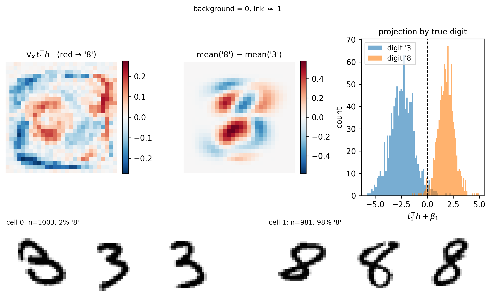
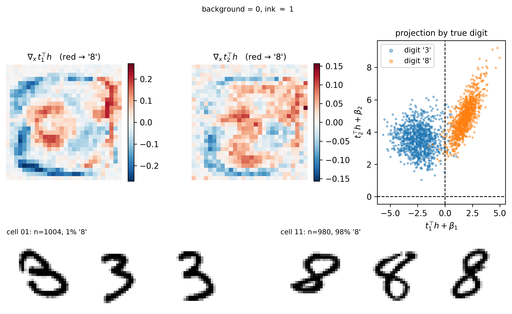
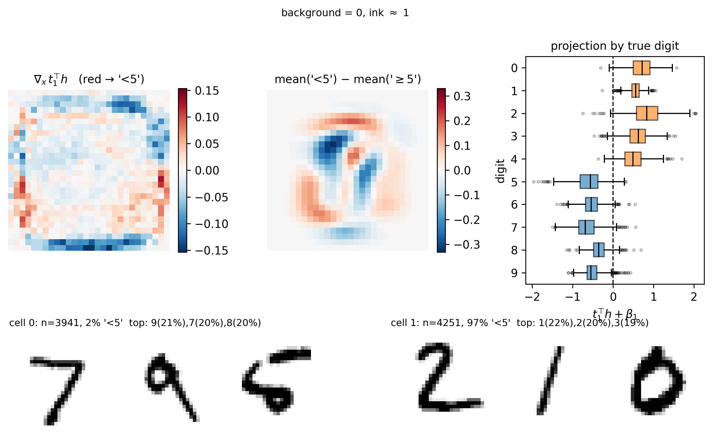
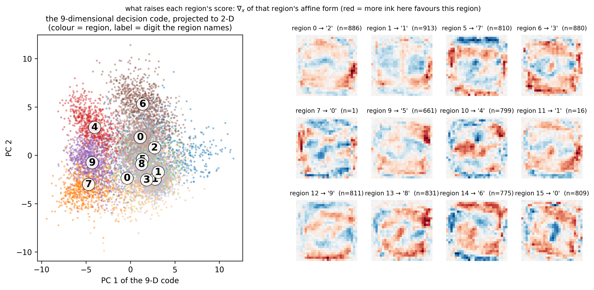

# Abstracting MNIST MLPs

Can a trained MLP's decision be described as a small number of discrete high-level variables read off one hidden
layer, such that the description survives *interventions* and not merely correlation?

The method is in [`src/algos/sigmoid_abstract.py`](../../src/algos/sigmoid_abstract.py); the theory, including the
conditions this is testing, is in [`../xor_study/THEORY.md`](../xor_study/THEORY.md).

## Setup

Networks are `784 -> 128 -> ReLU -> 128 -> ReLU -> C`, cut after the **first** hidden layer, so `h` is 128-dimensional
and the "tail" is everything after it. The target is always the **network's own predicted class**, never the true
label — we are explaining the network, not solving MNIST.

The high-level model gives each variable an orthonormal block of `h` and reads its value as the argmax of affine forms
on that block; a table maps the joint assignment to an output. Training patches a source input's block into a base
input's activation and asks the high-level model to predict what the network decides there.

Three numbers are reported throughout:

- **IIA** — agreement with the network's decision at intervened activations, under all subsets of variables.
- **purity** — how uniform the network's decision is *within* a region. This is the well-definedness condition: below
  1, two activations with the same high-level state give different outcomes, so no mechanism over those regions can be
  valid whatever the IIA.
- **control** — the same fit with the subspace frozen at random directions. IIA alone is not comparable across
  networks, so `skill = (IIA − base_rate)/(1 − base_rate)` is reported against a constant high-level model.

## Results

All with T learned, 3 seeds, scored on held-out inputs and freshly drawn interventions.

| task | high-level variables | dims | cells | IIA(all) | purity | control |
|---|---|---|---|---|---|---|
| 3 vs 8 | 1 binary | 1 | 2 | **0.996 ± 0.001** | 0.996 | +0.000 |
| 3 vs 8 | 2 binary | 2 | 4 | 0.832 ± 0.231 | 0.832 | +0.387 |
| digit < 5, net trained on it | 1 binary | 1 | 2 | **0.992 ± 0.000** | 0.992 | +0.030 |
| digit < 5, ten-class net pooled | 1 binary | 1 | 2 | 0.590 ± 0.046 | 0.628 | +0.000 |
| digit < 5, ten-class net pooled | 2 × 4-valued | 6 | 16 | 0.876 ± 0.021 | 0.855 | +0.253 |
| ten digits | 6 binary | 6 | 64 | 0.441 ± 0.011 | 0.443 | +0.152 |
| ten digits | 3 × 4-valued | 9 | 64 | 0.731 ± 0.069 | 0.715 | +0.234 |
| ten digits | 1 × 16-valued | 9 | 16 | **0.962 ± 0.008** | 0.951 | +0.037 |

Read the ten-digit rows together: at *equal cell count* (64), six binary variables reach 0.441 and three four-valued
ones 0.731; a single sixteen-valued variable on the same nine dimensions, with a quarter of the cells, reaches 0.962.
Multi-valued variables beat binary ones, and one variable beats several.

The second row is the known instability rather than a finding: with two binary variables the fit sometimes collapses
to a single realised region, giving the large spread. It is present in earlier versions of the code too.


## The abstractions, drawn

**One direction suffices for 3 vs 8**, and it is interpretable. The learned direction (left) is read against the
class-mean difference (middle): both put red (towards '8') through the centre and blue (towards '3') along the left
arc, but the learned feature also keys on a band down the right edge that the class means do not contain. Ink is a
*high* input value, so red means "more ink here pushes towards 8".



**A second variable is simply switched off.** Only 2 of 4 regions are realised: every activation sits on the same side
of the second boundary, so τ₂ is constant and the model is still effectively one variable. The scatter also shows the
two directions are correlated rather than complementary — t₂ recovers a weaker copy of t₁.



**"Is the digit < 5" is one feature too, when the network is trained on it.** Every digit 0–4 sits entirely on one
side and 5–9 on the other, with only whisker-level overlap, and the ordering *within* each group is arbitrary — so
this is not a digit code that happens to be thresholded, it is a feature built for the predicate.



**Ten digits need one multi-valued variable, not several binary ones.** The 9-dimensional decision code, projected to
2-D (left), with each region labelled by the digit it names; and what raises each region's score, pushed back to
pixels (right). Region '0' shows a hollow ring — ink in the centre argues *against* 0 — and region '1' a central
vertical stroke.



## What we concluded

- **Binary tasks have genuine, compressed abstractions.** One thresholded direction reproduces the network's decision
  at IIA ≈ 0.99 with a zero-skill control, on thousands of distinct activations — far from the regime where such a fit
  is automatic.
- **The abstraction is a property of the network, not the task.** The same predicate ("digit < 5") is one clean
  variable in a network trained on it (0.992), and needs six dimensions and two four-valued variables to reach 0.876 in
  a ten-class network whose output is pooled to that same predicate.
- **Ten-way classification does not decompose into binary parts.** At matched variable count and matched intervention
  family, binary variables fail where multi-valued ones succeed. The decision code is a single 9-dimensional object:
  splitting it across variables imposes a factorisation the network does not have.
- **Nine is predictable in advance.** A K-way argmax is shift-invariant, so it lives in K−1 dimensions; a rank-9 linear
  probe reproduces the network's decision 0.984 of the time and higher rank adds nothing. The centred tail-Jacobian
  spectrum shows a 2.6× gap after the ninth singular value — seconds of computation, no fitting, no interventions.
- **For *this* network the subspace is also derivable from the weights**, as the row space of the centred product of
  the tail's weight matrices, and freezing it there beats learning it (0.980 ± 0.001 against 0.964 ± 0.009). That
  shortcut works only because this tail is near-linear; the Jacobian spectrum is what tells you whether it applies, and
  `multiclass_code.py --weights-subspace` runs it as a control.
- **Compression yes, structure no.** The ten-class result is one variable feeding the output — a trivial graph. It says
  where the decision lives, not what intermediate steps produce it.

## Caveats

- A single-variable abstraction is the weakest non-trivial claim available: it says little more than "the decision is a
  function of a low-dimensional code", and exists whenever that is true. The discovery claim lives in whether *more
  than one* variable works.
- In the limit where one variable spans the whole layer, the intervention replaces `h` entirely and IIA collapses to
  observational accuracy — a linear probe in disguise. Content comes from the compression (`d/p`, cells against
  outcomes), not from IIA alone.
- `m` must exceed the number of outcomes by a margin. At `m = K` the fit often leaves one or two classes without a
  region at all; `m = K + 6` was reliable here. Surplus values die harmlessly, so report *realised* regions.
- Fits are seed-sensitive when `m` is close to `K` (±0.05 or worse); run several seeds.

## Reproducing

```bash
# k-sweeps with the random-subspace control, for each task
python mnist_abstraction.py --mode binary  --ks 1,2,4
python mnist_abstraction.py --mode lt5     --ks 1,2
python mnist_abstraction.py --mode lt5pool --ks 1,2,4      # the ten-class net, decision pooled to "< 5"
python mnist_abstraction.py --mode multi   --ks 4,6,8

# the figures
python mnist_abstraction.py --mode binary --visualise --vis-k 1      # and --vis-k 2
python mnist_abstraction.py --mode lt5    --visualise --vis-k 1
python multiclass_code.py                                            # add --weights-subspace for the control
```

Networks are trained once and cached in `../../data/mnist_mlp_{binary,multi,lt5}.pt`; pass `--retrain` to rebuild.
MNIST itself is read from the path in `MNIST_ROOT` at the top of `mnist_abstraction.py`.
